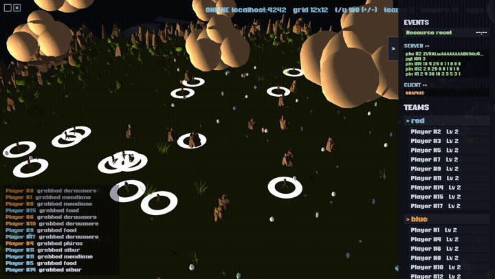
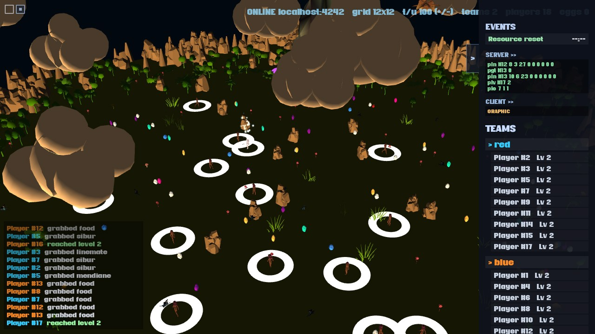
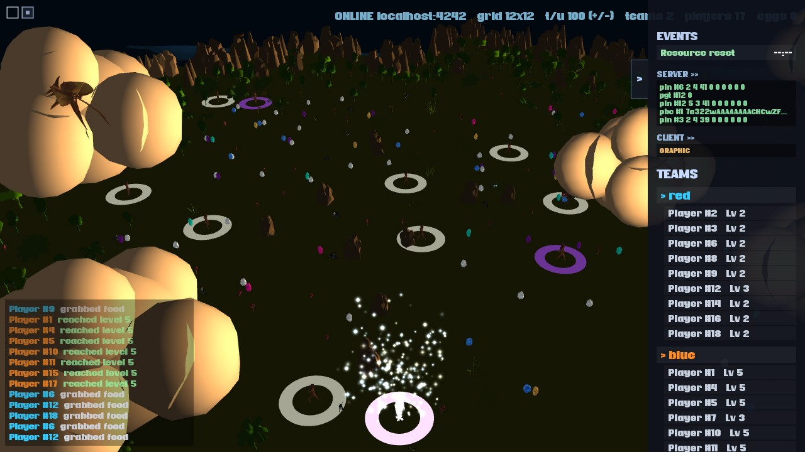

# Zappy - Trantor

A multiplayer network game in which AI-driven players gather resources and perform
elevation rituals on a toroidal map. The game server, the AI clients and the 3D GUI
talk to each other over TCP.

Teams of players start at level 1 and try to reach level 8. To level up, enough
players of the same level must stand on one tile together with the right stones,
then run an incantation. Players also need food to stay alive: each unit of food
lasts 126 time units.



| | |
| --- | --- |
|  |  |

A full game in one minute (accelerated about 2.5x, both teams climbing to level 7):
[docs/media/gui-demo.mp4](docs/media/gui-demo.mp4). Recorded with the demo camera
(`ZAPPY_CAM_ZOOM=2.2 ZAPPY_CAM_ORBIT=5`).

## Architecture

```
            TCP (AI protocol)                 TCP (GUI protocol)
 zappy_ai  ───────────────────►  zappy_server  ◄─────────────────  zappy_gui
 (Python, one process per player) (C++17)                          (C++/SFML/OpenGL)
```

| Component | Folder | Language | Role |
|---|---|---|---|
| Server | `server/` | C++17 | Owns the world: map, tiles, resources, players, eggs. Accepts AI and GUI clients on a single `poll()` loop with fixed-size circular buffers, queues each player's commands (up to 10 pending), runs them on a game clock driven by the frequency `-f`, handles food consumption and death, incantations, broadcasts and forks, and pushes events to connected GUIs. |
| AI | `ai/` | Python 3 (standard library only) | Autonomous client that drives one player. The first process of a team acts as a "queen" that keeps the team populated with `Fork` and child processes, then settles on one tile; workers stock food, bring her the stones for the whole climb, and the team climbs from level 2 to level 8 together on her tile. Team messages are encrypted and authenticated; the queen jams the other teams' messages. See [ai/DOCUMENTATION.md](ai/DOCUMENTATION.md). |
| GUI | `gui/` | C++17, SFML, OpenGL (GLEW, GLM) | 3D viewer: connects as a graphical client, receives the map and live events, and renders islands, players, resources and incantation effects, with a menu, HUD and day/night sky. |

### Server layers

The server is split into three layers that only talk through abstract interfaces:

```
 net/   TcpServer, Socket, Poller, RingBuffer        sockets, poll(), buffers; no game code
          │  IConnectionHandler (onConnect / onLine / onDisconnect)
          ▼  IClientSink        (send / closeAfterFlush)
 app/   GameSession, GuiProtocol, GameClock          handshake, roles, protocol text, time
          │  World (join / queueCommand / update)
          ▼  IWorldObserver     (onReply / onPlayerMoved / onIncantationStart / ...)
 game/  World, Player, Map, Tile, GameRules           rules only; no socket, no GUI text
```

- `game/` identifies players by id: a `Player` holds no file descriptor, and its state
  changes only through methods (`moveTo`, `removeItem`, `levelUp`, `tickFood`...).
  Every rule number (food duration, command costs, elevation table, densities) is in
  `GameRules.hpp`.
- `net/` is the only code that calls the C socket API, through the RAII `Socket` class
  (one owner per descriptor, closed exactly once) and `Poller` (around `poll()`). Each
  client has a 4 KiB input and a 1 MiB output `RingBuffer`: they never grow, a line longer
  than the input buffer or a client that never reads its replies is disconnected with a
  message, and a flood cannot slow other clients down.
- `app/GameSession` implements both interfaces: it maps connections to players or GUI
  viewers, and `GuiProtocol` builds every GUI message in one place.

Tests: `make -C server tests_run` (21 unit tests: buffers, parsing, options, game rules,
session with a fake network) and `python3 server/tests/network_tests.py` (fragmented
input, flood, random bytes, client that never reads, 300 simultaneous connections).

## Build

Requirements: `g++` with C++17, `make`, Python 3. The GUI also needs SFML 2.x,
GLEW, GLM and OpenGL, plus two header-only libraries (nlohmann/json, tinygltf)
that `gui/scripts/setup_libs.sh` installs into `~/.local/include`.

```bash
make            # server + gui + check that ai/zappy_ai exists
make server     # server only  -> server/zappy_server
make gui        # GUI only     -> gui/zappy_gui
make clean | fclean | re
```

The AI needs no build step.

## Run

**Server**

```bash
./server/zappy_server [-p port] [-x width] [-y height] [-n name1 name2 ...] [-c clientsNb] [-f freq] [-s seed]
```

Every option has a default, so `./server/zappy_server` alone starts a game.

| Flag | Meaning | Default |
|---|---|---|
| `-p` | TCP port (1-65535) | 4242 |
| `-x`, `-y` | map width and height (clamped to 42) | 10, 10 |
| `-n` | team names: unique, non-empty, no space, not `GRAPHIC` | Team1 Team2 Team3 Team4 |
| `-c` | initial slots per team | 3 |
| `-f` | frequency: time units per second (clamped to 10000) | 100 |
| `-s` | random seed, to replay the same map and spawns | random |

Invalid values (`-p abc`, `-n a a`, unknown option) stop the server with a message
and the usage.

**AI** (one player; the first process per team spawns its teammates)

```bash
cd ai && python3 zappy_ai -p 4242 -n team1 -h localhost
```

`-p` and `-n` are required, `-h` defaults to `localhost`. Optional environment
variables: `ZAPPY_AI_DELAY` (seconds per move, slows the AI down for viewing) and
`ZAPPY_DEBUG=1` (prints all traffic), `ZAPPY_TEAM_SECRET` (key of the team messages).

**GUI**

```bash
cd gui && ./zappy_gui -p 4242 -h localhost
```

The GUI plays an intro, then joins the game when you press START
(`ZAPPY_AUTOSTART` skips this). The 3D assets (about 1.2 GB) are not in git: download them once with
`./gui/scripts/fetch_assets.sh`, which fetches them from the `assets-v1` release and
checks their SHA-256. Credits and licenses: [gui/ASSETS.md](gui/ASSETS.md).
Every `ZAPPY_*` variable the GUI reads is listed, with its default, in
[`gui/include/app/GuiConfig.hpp`](gui/include/app/GuiConfig.hpp).

GUI controls:

| Input | Action |
| --- | --- |
| Left drag / mouse wheel | Orbit / zoom the camera |
| Left click on a player's tile | Select it: side panel opens with its inventory (polled every 0.33 s); click again to cycle through a crowded tile |
| SEE button (selected player) | Follow the player in third person |
| `+` / `-` (keypad) or PageUp / PageDown | Double / halve the server time unit (`sst`, 1..10000), shown as `t/u` in the top bar |
| Tab | Show / hide the teams panel |
| G | Server tile grid and tile tooltip |
| N | Cycle day/night: auto, night, day |
| R | Reset the camera |
| F11 | Fullscreen |
| Esc | Leave POV, then deselect, then quit |

**Demo**

```bash
./run_demo.sh [MOVE_SEC] [PORT]   # server (20x20, 2 teams, -c 9, -f 100) + one AI per team + GUI
./test_fork.sh [PORT]             # 4 teams with one slot each, to watch Fork grow the teams
```

## AI results

The AI reliably wins: a team gets 6 players to level 8. Measured with
[`tools/benchmark.py`](tools/benchmark.py) on 16 headless games (server at `-f 100`, 9 slots per team):

| Games | Runs | Result |
| --- | --- | --- |
| previous AI vs itself, 20×20 | 5 | 0 wins after 30,000 time units, stuck at level 5 or 6 |
| current AI vs itself, 20×20 | 5 | 5 wins, after 6,800 to 8,060 time units |
| current AI vs previous AI, 20×20 | 3 | 3 wins for the current AI |
| 4 teams of the current AI, 10×10 | 3 | 3 wins, after 6,730 to 7,260 time units |

Team messages are encrypted and authenticated (HMAC-SHA256, replay protection), and the
queen re-broadcasts corrupted copies of the other teams' messages; the measured effect of
this jamming is small, see the documentation.

The previous AI climbed by pairs and the team split into groups of different levels that could never gather
the 4 or 6 players of the higher levels. The current one keeps the team on one tile from level 2 to 8. Details
and limits in [ai/DOCUMENTATION.md](ai/DOCUMENTATION.md#7-results-and-limits).

```bash
make server
python3 tools/benchmark.py --teams red,blue    # headless game, prints levels until a team wins
```

## Protocol

Both protocols are documented in [`protocol/`](protocol/):

- [`ai_protocol.md`](protocol/ai_protocol.md): handshake, player commands, time costs, asynchronous messages
- [`gui_protocol.md`](protocol/gui_protocol.md): graphical client commands and server events
- [`commands.md`](protocol/commands.md): one-page cheat sheet

## Team

Built by a team of six.

**My contribution (Ridwane777):** the game server core - World/Map/Tile/Player model,
command queue and game clock (time unit), resource consumption and player death,
incantation (two-phase synchronization), sound broadcast direction, and GUI protocol
event broadcasting.

**After the school project (Ridwane777):** the pack strategy of the AI (`ai/logic/pack.py`), which made it
win, the encrypted team messages and the jammer (`ai/comm/`), the AI's layered rewrite with
its tests, the server's layered rewrite (`server/`), and the benchmark tool (`tools/benchmark.py`).
The first AI is kept in the git tag `legacy-ai`.

Teammates:

- Espoir Biaou ([@Knight-coder-19](https://github.com/Knight-coder-19))
- Jean-Daniel Kangni ([@Black_nexus06](https://github.com/Black_nexus06))
- Chabda Gbemetonou ([@chabda01](https://github.com/chabda01))
- Huziane Tonawa
- Peniel Amoussou

## License

[MIT](LICENSE)
